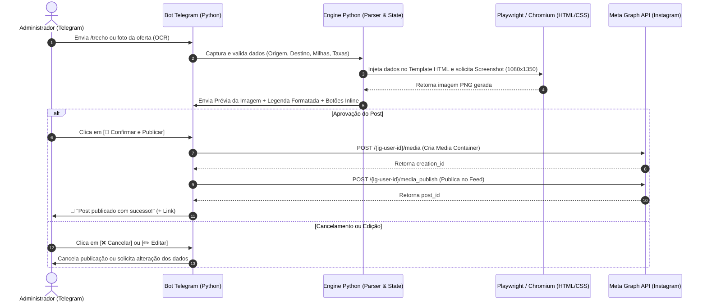

# 🏛️ ARCHITECTURE - Arquitetura e Infraestrutura do Sistema

---

## 1. Visão Geral da Arquitetura

O **Passageiro 100 Milhas Bot** adota uma arquitetura headless orientada a serviços assíncronos, operando no modelo **CMS via Telegram com Human-in-the-Loop**. O Telegram funciona como interface de controle única para capturar parâmetros, renderizar artes visuais e despachar publicações para as redes da Meta.

```text
[Telegram Admin] ──> [Bot Telegram (Python)] ──> [Engine & Validator]
                                                       │
                                                       ▼
                                            [Playwright Renderer]
                                                       │ (HTML/CSS -> PNG 1080x1350)
                                                       ▼
[Telegram Preview + Inline Keyboard] <────────── [Preview PNG]
        │
        └─ (Ao aprovar) ──> [Meta Graph API] ──> [Post no Feed Instagram/FB]
```

### 1.1 Diagrama Sequencial de Operação (MVP)



---

## 2. Stack Tecnológica

| Componente | Tecnologia / Ferramenta | Justificativa |
| :--- | :--- | :--- |
| **Linguagem Principal** | Python 3.11+ | Facilidade assíncrona, robustez e ecossistema de APIs. |
| **Interface Administrativa** | `python-telegram-bot` (v21+) | Framework assíncrono moderno com suporte nativo a ConversationHandlers e InlineKeyboards. |
| **Validação de Dados** | Pydantic v2 | Garantia estrita de tipos para os dados de entrada das emissões. |
| **Motor de Templates** | Jinja2 | Injeção dinâmica de variáveis em templates HTML/CSS sem dependências externas. |
| **Renderização Gráfica** | Chromium CLI / Playwright | Captura precisa de layouts web modernos em alta resolução (1080x1350px). |
| **Publicação Externa** | Meta Graph API (Instagram Business) | Endpoints oficiais para publicação no feed sem risco de bloqueios. |
| **Extração Inteligente (OCR)** | Google Gemini / DeepSeek API | Extração estruturada a partir de prints de tela. |
| **Contêineres** | Docker & Docker Compose v2 | Padronização e facilidade de deploy multiplataforma. |
| **Nuvem e Hospedagem** | Microsoft Azure for Students (VM B1s) | Infraestrutura 24/7 de alta confiabilidade com custo coberto por créditos acadêmicos. |

---

## 3. Estrutura de Diretórios e Módulos

```text
passageiro100milhas-bot/
├── .agents/                      # Configurações do ambiente de agentes e regras
│   └── rules/                    # Regras de conduta, commit e documentação
│       ├── commit_convention.md
│       └── project_docs.md
├── docs/                         # Documentação oficial do projeto (Padrão 9 Docs)
│   ├── PRD.md
│   ├── ARCHITECTURE.md
│   ├── DATABASE.md
│   ├── SECURITY.md
│   ├── RULES.md
│   ├── DESIGN_SYSTEM.md
│   ├── TASKS.md
│   ├── MEMORY.md
│   └── AGENTS.md
├── output/                       # Mídias temporárias geradas (.png)
├── services/                     # Módulos desacoplados de serviços
│   ├── telegram_bot.py           # Handlers e fluxos de conversa do Telegram
│   ├── renderer.py               # Renderizador Playwright / Chromium CLI + Jinja2
│   ├── meta_api.py               # Cliente HTTP assíncrono da Meta Graph API
│   └── ocr_extractor.py          # Extração de texto/dados via IA e visão
├── templates/                    # Templates visuais dos posts (HTML/CSS)
│   ├── trecho_template.html      # Template para Alerta de Trecho (Milhas)
│   └── promo_template.html       # Template para Informativo de Promoção
├── .env.example                  # Modelo de variáveis de ambiente
├── config.py                     # Leitura e validação das variáveis do .env
├── Dockerfile                    # Receita da imagem Docker (Python + Chromium)
├── docker-compose.yml            # Orquestração do serviço do bot
├── main.py                       # Ponto de entrada do sistema
├── README.md                     # Apresentação do repositório
└── requirements.txt              # Dependências do projeto
```

### 3.1 Responsabilidades dos Módulos em `services/`
- **`services/telegram_bot.py`**: Gerencia comandos (`/trecho`, `/promo`), diálogos passo a passo, captura de fotos e callbacks de botões de aprovação/edição.
- **`services/renderer.py`**: Compila templates Jinja2 com os dados do post e executa o Chromium headless para extrair a imagem em formato PNG 1080x1350.
- **`services/meta_api.py`**: Encapsula as requisições assíncronas para a Meta Graph API (`/{ig-user-id}/media` e `/{ig-user-id}/media_publish`).
- **`services/ocr_extractor.py`**: Envia imagens recebidas para o modelo multimodal estruturar JSON compatível com o schema do post.

---

## 4. Detalhamento do Fluxo Operacional (5 Etapas)

### 📍 Etapa 1: Captura de Dados (Telegram)
- **Formulário Guiado:** Via comandos `/trecho` ou `/promo`, o bot conduz diálogo via `ConversationHandler` recolhendo:
  - Origem e Destino (IATA)
  - Classe, Companhia e Programa
  - Milhas e Taxas
  - Período de Datas
  - Imagem de fundo opcional.
- **Extração Inteligente (OCR):** Admin envia print da tela de emissão, o parser extrai as entidades e solicita apenas validação.

### ⚙️ Etapa 2: Estruturação & Validação (Python Core)
- Os dados são validados via Pydantic e a legenda editorial padrão é montada de acordo com as diretrizes do `DESIGN_SYSTEM.md`.

### 🎨 Etapa 3: Renderização Gráfica em Alta Fidelidade
- Compilação do template Jinja2.
- Abertura de viewport 1080x1350 via Chromium CLI/Playwright.
- Gravação do PNG em `output/` com timestamp único.

### 👁️ Etapa 4: Prévia e Aprovação (Human-in-the-Loop)
- O bot envia no Telegram a foto final, o texto formatado da legenda e o teclado inline interativo com ações de publicação, edição ou descarte.

### 🌐 Etapa 5: Publicação na Meta Graph API
Ao receber a confirmação:
1. A imagem é disponibilizada via URL pública acessível para a Meta.
2. É criado o *Media Container* (`POST /{ig-user-id}/media`).
3. O status do processamento do container é checado.
4. É disparado o *Publish* (`POST /{ig-user-id}/media_publish`).
5. O bot retorna o permalink oficial da publicação no Telegram.

---

## 5. Infraestrutura e Estratégia de Deploy

### 5.1 Análise de Provedores de Hospedagem

| Provedor | Modelo | Avaliação no Projeto | Decisão |
| :--- | :--- | :--- | :--- |
| **Render** | Plano Free | Limite de 750h compartilhadas por conta; hiberna após 15 min sem tráfego HTTP. Inviável para bot em polling contínuo. | Descartado |
| **Oracle Cloud** | Always Free | Políticas rigorosas de verificação antifraude que bloquearam o cadastro. | Descartado |
| **Microsoft Azure for Students** | Acadêmico | **US$ 100 em créditos anuais** + **VM B1s gratuita perpétua (750h/mês)** sem exigir cartão de crédito. | **Selecionado** |

### 5.2 Comparativo: Docker Compose Direto vs. Coolify na Azure VM

| Critério | Docker Compose Direto (Adotada) | Coolify na VM Azure |
| :--- | :--- | :--- |
| **Tamanho da VM** | `Standard_B1s` (1 vCPU, 1 GB RAM + 2 GB Swap) | `Standard_B2s` (2 vCPUs, 4 GB RAM) |
| **Custo Mensal** | **R$ 0,00** (coberto pelas 750h gratuitas da B1s) | ~US$ 25 a US$ 30 / mês (consome os US$ 100) |
| **Duração do Benefício** | **12 meses ininterruptos** | **~3 a 4 meses** até esgotar os créditos |
| **Gerenciamento** | Terminal SSH + `docker compose` | Interface web gráfica |
| **Estabilidade** | Leve e estável | Competição de RAM entre Coolify, Postgres e Bot |

> **Decisão Operacional:** Deploy direto via **Docker Compose em VM Ubuntu B1s** para manter o bot ativo 24/7 gratuitamente durante todo o ano acadêmico.

### 5.3 Roteiro de Provisionamento e Deploy na VM Azure

#### Passo 1: Criação da Máquina Virtual no Portal Azure
- **Assinatura:** `Azure for Students`
- **Grupo de Recursos:** `rg-passageiro100milhas`
- **Nome da VM:** `vm-passageiro100milhas`
- **Região:** `East US`
- **Sistema Operacional:** `Ubuntu 24.04 LTS` (Gen2)
- **Tamanho:** `Standard_B1s` (1 vCPU, 1 GiB RAM)
- **Portas liberadas:** SSH (porta 22)

#### Passo 2: Comandos de Instalação e Execução via SSH
```bash
# 1. Conectar via SSH
ssh seu_usuario@ip_da_vm

# 2. Instalar Docker e Git
sudo apt update && sudo apt install -y docker.io docker-compose-v2 git

# 3. Clonar repositório
git clone https://github.com/saireshub/passageiro100milhas-bot.git
cd passageiro100milhas-bot

# 4. Configurar variáveis de ambiente
nano .env

# 5. Iniciar container em background
sudo docker compose up -d --build

# 6. Acompanhar logs em tempo real
sudo docker compose logs -f
```
