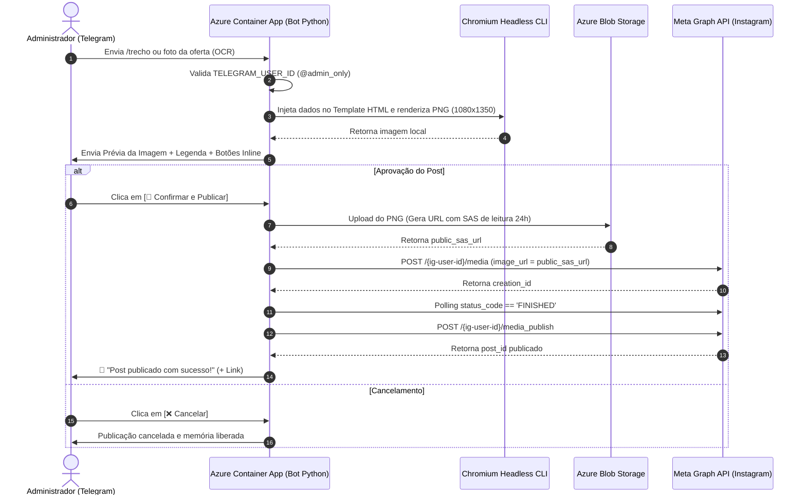

# 🏛️ ARCHITECTURE - Arquitetura e Infraestrutura do Sistema

---

## 1. Visão Geral da Arquitetura

O **Passageiro 100 Milhas Bot** adota uma arquitetura orientada a serviços assíncronos e sem servidor (*serverless containers*), operando no modelo **CMS via Telegram com Human-in-the-Loop**. O Telegram funciona como interface de controle única para capturar parâmetros, renderizar artes visuais e despachar publicações para as redes da Meta.

```text
[Telegram Admin] ──> [Bot Telegram (Python / Polling)] ──> [Engine & Validator]
                                                                  │
                                                                  ▼
                                                      [Playwright / Chromium CLI]
                                                                  │ (HTML/CSS -> PNG 1080x1350)
                                                                  ▼
[Telegram Preview + Inline Keyboard] <────────────────── [Preview PNG]
        │
        └─ (Ao aprovar) ──> [Upload Azure Blob Storage (SAS 24h)]
                                      │
                                      ▼
                             [Meta Graph API] ──> [Post no Feed Instagram/FB]
```

### 1.1 Diagrama Sequencial de Operação



---

## 2. Stack Tecnológica

| Componente | Tecnologia / Ferramenta | Justificativa |
| :--- | :--- | :--- |
| **Linguagem Principal** | Python 3.12+ | Alta performance com CPython 3.12, tipagem moderna e ecossistema assíncrono. |
| **Interface Administrativa** | `python-telegram-bot` (v21+) | Framework assíncrono moderno com suporte nativo a ConversationHandlers e InlineKeyboards. |
| **Validação de Dados** | Pydantic v2 | Garantia estrita de tipos para os dados de entrada das emissões. |
| **Motor de Templates** | Jinja2 | Injeção dinâmica de variáveis em templates HTML/CSS sem dependências externas. |
| **Renderização Gráfica** | Chromium CLI Headless | Captura precisa de layouts web modernos em alta resolução (1080x1350px). |
| **Hospedagem das Imagens** | Azure Blob Storage | Armazenamento de alta disponibilidade com geração de URLs SAS temporárias (24h). |
| **Publicação Externa** | Meta Graph API (Instagram & Facebook) | Endpoints oficiais para publicação simultânea (crossposting) no feed do Instagram e na Página do Facebook. |
| **Extração Inteligente (IA)** | Google Gemini (Multimodal Vision & Text) | Extração estruturada (JSON) a partir de prints de tela (fotos) e textos de promoções. |
| **Contêineres & Orquestração**| Azure Container Apps (ACA) | Execução serverless 24/7 sem necessidade de gerenciar VMs, SO ou patches. |
| **Registro de Imagens** | Azure Container Registry (ACR) | Repositório privado da imagem Docker integrada ao pipeline de deploy. |
| **Integração Contínua (CI/CD)**| GitHub Actions & Docker Buildx | Compilação com cache GHA e geração automática de tags imutáveis (:sha-xxxxxxx e :latest). |

---

## 3. Estrutura de Diretórios e Módulos

```text
passageiro100milhas-bot/
├── .agents/                      # Configurações do ambiente de agentes e regras
├── .github/
│   └── workflows/
│       └── deploy.yml            # Pipeline CI/CD no GitHub Actions (Build, Push & Deploy OIDC)
├── docs/                         # Documentação oficial do projeto
│   ├── PRD.md
│   ├── ARCHITECTURE.md
│   ├── DATABASE.md
│   ├── SECURITY.md
│   ├── RULES.md
│   ├── DESIGN_SYSTEM.md
│   ├── TASKS.md
│   ├── MEMORY.md
│   └── AGENTS.md
├── output/                       # Mídias temporárias geradas (.png removidas após postagem)
├── services/                     # Módulos desacoplados de serviços
│   ├── telegram_bot.py           # Handlers e fluxos com trava @admin_only e limpeza de temp
│   ├── gemini_service.py         # Extração multimodal (Vision & Text) via Google Gemini
│   ├── renderer.py               # Renderizador Chromium CLI + Jinja2 (autoescape=True)
│   ├── storage_service.py        # Integração Azure Blob Storage com SAS 24h
│   └── meta_api.py               # Cliente Meta Graph API (Crossposting Instagram & Facebook)
├── templates/                    # Templates visuais dos posts (HTML/CSS)
│   ├── trecho_template.html      # Template para Alerta de Trecho (Milhas)
│   ├── promo_template.html       # Template para Informativo de Promoção
│   └── assets/                   # Logotipos SVG da marca
├── .dockerignore                 # Exclusão de arquivos do contexto de build
├── .env.example                  # Modelo de variáveis de ambiente
├── config.py                     # Leitura e validação das variáveis do .env
├── Dockerfile                    # Receita multi-stage (Python 3.12 + Chromium não-root)
├── compose.yaml                  # Orquestração local do serviço do bot
├── main.py                       # Ponto de entrada do sistema
├── README.md                     # Apresentação do repositório
└── requirements.txt              # Dependências enxutas (Telegram, Pillow, Jinja2, Azure Blob)
```

---

## 4. Infraestrutura e Topologia na Azure

Todos os recursos do projeto estão centralizados em um único grupo de recursos na região **Mexico Central** (`mexicocentral`), garantindo latência otimizada e conformidade com a política regional da assinatura.

| Recurso | Nome na Azure | Tipo | Especificação |
| :--- | :--- | :--- | :--- |
| **Grupo de Recursos** | `rg-passageiro100milhas-mx` | Resource Group | Região: Mexico Central |
| **Ambiente de Contêiner** | `env-passageiro100milhas` | Container Apps Environment | Express Profile, Logs: None |
| **Aplicativo de Contêiner** | `app-passageiro100milhas` | Container App | 0.5 vCPU, 1.0 GiB RAM, Ingress desabilitado |
| **Registro de Imagens** | `crpassageiro100milhas` | Container Registry (ACR) | SKU Basic, Admin Enabled |
| **Armazenamento de Blobs**| `stpassageiro100milhas` | Storage Account | LRS Hot, Container: `passageiro100milhasbot` |
| **Identidade Federada CI/CD**| `id-github-passageiro100milhas` | User-Assigned Managed Identity | Role Contributor no RG, OIDC com GitHub Actions |

---

## 5. Pipeline de CI/CD (GitHub Actions)

A esteira de deploy automático opera através do arquivo [`.github/workflows/deploy.yml`](file:///.github/workflows/deploy.yml) com autenticação nativa **OpenID Connect (OIDC)** via Identidade Gerenciada:

```text
[Desenvolvedor] ── git push origin main ──> [GitHub Actions Runner]
                                                   │
                                                   ├─► 1. Checkout do código (actions/checkout@v4)
                                                   ├─► 2. Setup Docker Buildx (docker/setup-buildx-action@v3)
                                                   ├─► 3. Login no ACR (crpassageiro100milhas.azurecr.io)
                                                   ├─► 4. Extração de tags via docker/metadata-action@v5
                                                   │      ├── :sha-<commit_curto> (tag imutável e única)
                                                   │      ├── :latest (ponteiro de conveniência)
                                                   │      └── :main (branch de produção)
                                                   ├─► 5. Compilação com injeção de COMMIT_SHA e cache BuildKit (gha)
                                                   ├─► 6. Autenticação Azure OIDC sem senhas (azure/login@v2)
                                                   └─► 7. Atualização automática do Azure Container Apps (CD 100% autônomo)
```

### Estratégia de Versionamento e Tags Docker
Seguindo as melhores práticas oficiais da documentação do Docker (`docker-build-strategies`):
1. **Tags Imutáveis (`:sha-xxxxxxx`):** Cada commit gera uma imagem com identificador único baseado no commit SHA do Git, garantindo rastreabilidade exata e prevenindo problemas de cache em nós do Azure Container Apps.
2. **Deploy Automático sem Cliques (CD):** O GitHub Actions assume a identidade `id-github-passageiro100milhas` via OIDC e executa `az containerapp update` diretamente com a tag única do commit, criando uma nova revisão na hora.
3. **Injeção de Metadados (`COMMIT_SHA`):** O commit SHA é injetado como variável de ambiente no container em tempo de build, permitindo que o bot informe sua versão exata em tempo de execução através do comando `/status` no Telegram.
4. **Cache BuildKit GitHub Actions (`type=gha`):** As camadas do Dockerfile são cacheadas nativamente entre execuções do workflow, reduzindo o tempo de compilação de minutos para segundos.
