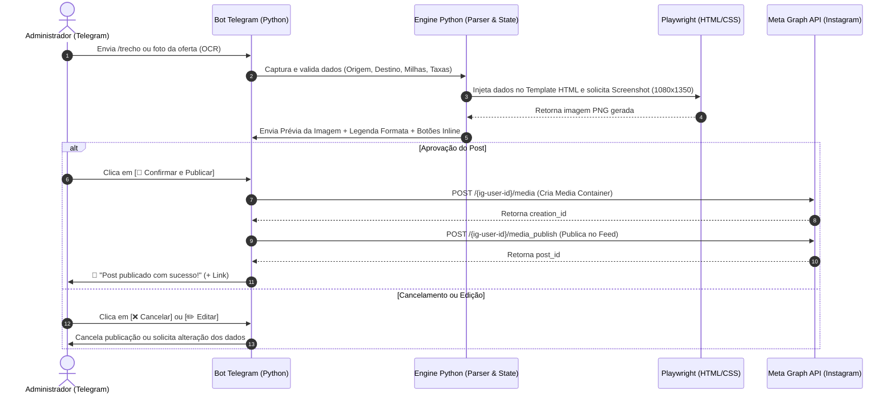

# Arquitetura e Fluxo Operacional Detalhado (MVP)

Este documento descreve detalhadamente o funcionamento interno, o fluxo de dados e os módulos do **Passageiro 100 Milhas Bot**.

---

## 1. Visão Geral da Arquitetura

O sistema opera com o conceito de **CMS via Telegram com aprovação humana (Human-in-the-Loop)**. O Telegram funciona como a única interface de controle necessária para o administrador criar, revisar e autorizar publicações no Instagram e Facebook.



---

## 2. Detalhamento do Fluxo em 5 Etapas

### 📍 Etapa 1: Captura de Dados (Telegram Interface)
* **Forma de Entrada A (Formulário Guiado):**
  * O administrador inicia o comando `/trecho` ou `/promo`.
  * O bot conduz uma conversa rápida (ConversationHandler) solicitando os dados mínimos:
    - Origem e Destino (ex: `GRU`, `MIA`)
    - Classe (`Econômica`, `Executiva`)
    - Companhia & Programa (`LATAM Pass`, `Smiles`, etc.)
    - Custo em Milhas (`45.000`) e Taxas (`R$ 250,00`)
    - Período de Datas (`Outubro/2026`)
    - Imagem de Fundo (Upload opcional da foto do destino ou usa imagem padrão).
* **Forma de Entrada B (Extração Inteligente por Imagem / OCR):**
  * O administrador envia um print da tela do programa de milhas.
  * O módulo de OCR / IA processa o print e preenche o formulário automaticamente, solicitando apenas confirmação.

---

### ⚙️ Etapa 2: Estruturação & Validação (Python Core)
* Os dados recebidos são estruturados em um objeto de dados (Schema Pydantic):
  ```python
  class PostTrechoData(BaseModel):
      origem_iata: str
      destino_iata: str
      classe: str
      companhia: str
      programa: str
      milhas: str
      taxas: str
      datas: str
      imagem_fundo_url: Optional[str] = None
  ```
* É gerada a legenda formatada padrão de acordo com o template editorial definido no `README.md`.

---

### 🎨 Etapa 3: Renderização de Imagem em Alta Resolução (Playwright)
* **Template HTML/CSS:** Arquivos com design moderno (`1080x1350px`, proporção 4:5 otimizada para o feed do Instagram).
* **Motor de Renderização (Playwright Headless Chromium):**
  1. Carrega o template HTML compilado via Jinja2 com os dados do post.
  2. Ajusta o viewport exatamente para `1080x1350`.
  3. Captura o screenshot da div principal em formato PNG sem perdas de qualidade.
  4. Salva a mídia temporária na pasta `/output` ou faz upload para o storage.

---

### 👁️ Etapa 4: Prévia & Aprovação (Human-in-the-Loop)
* O bot Telegram responde na mesma conversa enviando:
  1. A imagem PNG final gerada pelo Playwright.
  2. A legenda do post formatada com emojis e Markdown.
  3. Teclado inline interativo:
     - `[🚀 Confirmar e Publicar]`
     - `[✏️ Editar Dados]`
     - `[❌ Cancelar]`

---

### 🌐 Etapa 5: Publicação Automática na Meta Graph API
Ao clicar em `[🚀 Confirmar e Publicar]`:
1. **Upload da Mídia:** A imagem gerada é disponibilizada através de uma URL pública temporária (ou via servidor local/Cloudflare R2).
2. **Criação do Container (Media Container):**
   - Requisição `POST` para `https://graph.facebook.com/v19.0/{ig-user-id}/media`
   - Parâmetros: `image_url`, `caption` (legenda), `access_token`.
3. **Verificação do Status:** Chamada de verificação para garantir que o Instagram concluiu o processamento da imagem.
4. **Publicação no Feed:**
   - Requisição `POST` para `https://graph.facebook.com/v19.0/{ig-user-id}/media_publish`
   - Parâmetro: `creation_id`.
5. **Confirmação Final:** O bot atualiza a mensagem no Telegram confirmando a publicação com sucesso e fornecendo o permalink do post.

---

## 3. Estrutura Modular Proposta para o Projeto

```text
passageiro100milhas-bot/
├── config.py                 # Leitura das variáveis do .env (Tokens, Keys, IDs)
├── main.py                   # Ponto de entrada do Bot Telegram
├── requirements.txt          # Dependências do projeto Python
├── .env                      # Credenciais e configurações locais
│
├── services/                 # Módulos de serviço desacoplados
│   ├── telegram_bot.py       # Handlers e fluxos de conversa do Telegram
│   ├── renderer.py           # Renderizador Playwright + Jinja2
│   ├── meta_api.py           # Cliente HTTP da Meta Graph API (Instagram/Facebook)
│   └── ocr_extractor.py      # Extração de texto/dados via OCR (DeepSeek/Vision)
│
├── templates/                # Templates visuais dos posts (HTML/CSS)
│   ├── trecho_template.html  # Template para Alerta de Trecho (Milhas)
│   └── promo_template.html   # Template para Informativo de Promoção
│
└── output/                   # Armazenamento temporário de imagens geradas (.png)
```
